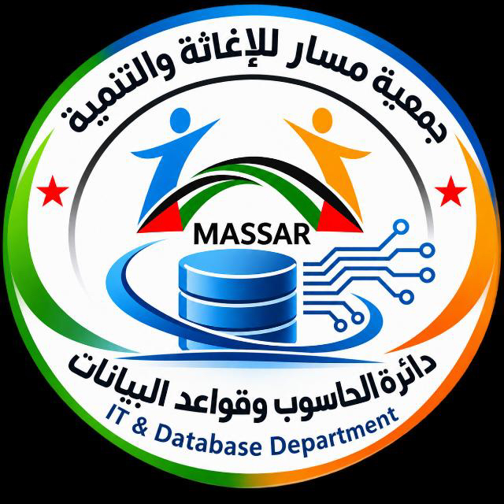

# IT & Database Department
### Massar Association for Relief & Development

Building technology that serves relief and development work in Palestine 🇵🇸

---

## 👋 Who We Are

We are the technical team at **Massar Association for Relief & Development**.
We build the systems that help the association reach beneficiaries quickly,
accurately, and fairly — and we protect their data as a trust.

## 🎯 What We Do

- 🗂️ **Beneficiary Management:** registration, deduplication, and aid history
- 🌐 **Web Applications:** dashboards and reports for management and donors
- 📱 **Android Apps:** field data collection and distribution, even offline
- 🛢️ **Databases:** design, data cleaning, backups, and reporting
- 🖥️ **Infrastructure:** servers, networks, and technical support

## 👥 Our Teams

| Team | Focus |
|---|---|
| `@web` | Web applications and dashboards |
| `@android` | Android field apps |
| `@database` | Databases and reporting |
| `@leads` | Code review and coordination |

## 🔐 Our Principles

- **Beneficiary data is a trust:** no real personal data in any repository
- **No secrets in code:** passwords and keys live in `.env` files only
- **Every change is reviewed:** Issue → Branch → Pull Request → Review
- **Simplicity first:** we build what the field actually needs

## 🛠️ Tech Stack

`Laravel` · `PHP` · `MySQL / MariaDB` · `Kotlin` · `Android` · `Linux` · `Git`

---

**Massar Association for Relief & Development**
📍 Gaza, Palestine

